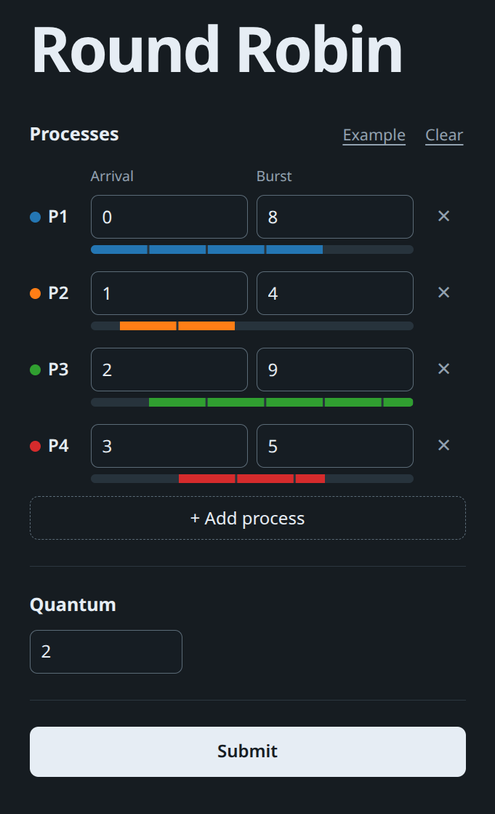
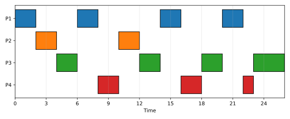

# WebScheduler

***

> [!NOTE]
> This is not full documentation.
> This file contains repository description and basic instructions only.

A web-based Round Robin CPU scheduling simulator built with `Python` and `Flask`.
Enter a quantum and a table of processes (arrival time, burst time) and get
the average waiting time and a Gantt Diagram as SVG.

**Live demo:** http://13.49.66.71:80

## Example

The first thing you see on the page looks like this:

<p align="center">
  
</p>

It is the basic example.

Now press **Submit** and you will see this:



***

Also, you can change quantum, arrival times and burst times, set it up however you want!

## Installation & Setup

> [!NOTE]
> Minimal version `Python 3.14.8`

1. **Clone the repository:**
   ```bash
   git clone https://github.com/ikindor/WebScheduler.git
   cd WebScheduler
   ```

2. **Create and activate a virtual environment:**
   ```bash
   # On Windows
   python -m venv .venv
   .venv\Scripts\activate

   # On macOS/Linux
   python3 -m venv .venv
   source .venv/bin/activate
   ```

3. **Install dependencies:**
   ```bash
   pip install -r requirements.txt
   ```

4. **Run the application:**
   ```bash
   python app.py
   ```

5. **Open in your browser:**  
   Navigate to `http://127.0.0:5000` to start using the simulator.